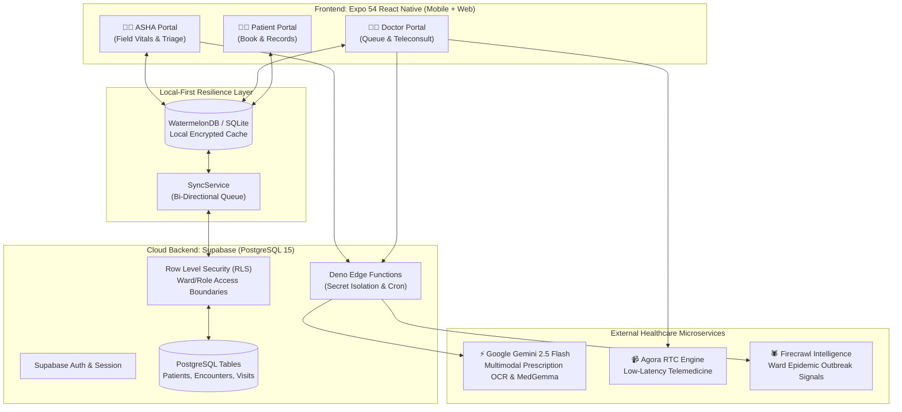

# 🏆 VitaWeave - Hackathon Round 3: Peer Defense & Evaluation Guide

> **Rural Health. Connected.**  
> A mobile-first, offline-resilient community health operating system bridging **ASHA Frontline Workers**, **PHC Doctors**, and **Rural Patients** through local-first persistence, edge-proxied **Gemini 2.5 Flash & MedGemma** clinical intelligence, and low-bandwidth **Agora Telemedicine**.

---

## 📌 Round 3 Fast Navigation
- [1. Executive Pitch & The Problem](#1-executive-pitch--the-problem)
- [2. Quickstart & Installation (Run in 2 Minutes)](#2-quickstart--installation-run-in-2-minutes)
- [3. System Architecture & Data Flow](#3-system-architecture--data-flow)
- [4. Role-by-Role Feature Breakdown](#4-role-by-role-feature-breakdown)
- [5. Winning 3-Minute Live Demo Script](#5-winning-3-minute-live-demo-script)
- [6. The Defense Shield: Top 15 Tough Questions & Answers](#6-the-defense-shield-top-15-tough-questions--answers)
- [7. Code Quality & Automated Test Validation](#7-code-quality--automated-test-validation)

---

## 1. Executive Pitch & The Problem

### The Crisis in Rural Indian Healthcare
India’s National Health Mission relies on **~1 million ASHA workers** (Accredited Social Health Activists) to serve 800+ million rural citizens. Yet:
1. **Paper-Bound Bottleneck**: Patient triage, maternal ANC/PNC cards, and immunization logs stay trapped in physical notebooks.
2. **Doctor Scarcity & Distance**: A rural patient travels 20–50 km to a Primary Health Centre (PHC) only to find overcrowding or unavailable specialists.
3. **Delayed Outbreak Signals**: Dengue, malaria, and waterborne clusters are caught weeks late because ward-level symptoms aren't aggregated in real time.
4. **Intermittent Connectivity**: Rural sub-centres operate in 2G/3G dead zones where typical cloud-first apps crash or hang.

### The VitaWeave Solution
VitaWeave provides a unified, cross-platform mobile & web operating system with **three dedicated role experiences**:
- **👩‍⚕️ ASHA Worker**: Offline-first patient registry, automated clinical urgency scoring, maternal/child tracking, and vernacular MedGemma AI assistant.
- **👨‍⚕️ Doctor**: Triage queue prioritized by clinical risk, 1-click low-bandwidth telemedicine, prescription OCR, and structured clinical encounter notes.
- **🧑‍🌾 Patient**: Vernacular appointment booking with immediate feedback, digital health passports, and teleconsultations.

---

## 2. Quickstart & Installation (Run in 2 Minutes)

### Prerequisites
- **Node.js**: v18.0.0 or higher (`node -v`)
- **Package Manager**: `npm` (comes with Node)
- **Expo CLI**: bundled via `npx expo`
- **Device Options**: Any Modern Web Browser (Chrome/Safari), Android device with Expo Go, or iOS device.

### Step 1: Clone & Install Dependencies
```bash
# Navigate to the project directory
cd VitaWeave

# Install verified dependencies
npm install
```

### Step 2: Environment Configuration
Copy `.env.example` to `.env` (a working pre-configured environment is already provided for the hackathon):
```bash
cp .env.example .env
```

Ensure the key variables are set in `.env`:
```env
# Supabase Backend & PostgreSQL
EXPO_PUBLIC_SUPABASE_URL="https://tvrznpoveyclcivycaxx.supabase.co"
EXPO_PUBLIC_SUPABASE_ANON_KEY="<your-supabase-anon-key>"

# Google Gemini AI & Clinical Decision Support (Gemini 2.5 Flash)
EXPO_PUBLIC_GEMINI_API_KEY="<your-gemini-api-key>"
EXPO_PUBLIC_GEMINI_MODEL="gemini-2.5-flash"

# Agora Low-Bandwidth Telemedicine
EXPO_PUBLIC_AGORA_APP_ID="1042f8054d504c8e977f6ba2f7ea6f"

# Production Edge Proxying
EXPO_PUBLIC_USE_EDGE_PROXY="true"
```

### Step 3: Launch the Application
Run the Expo bundler:
```bash
# Start Expo development server (clearing cache)
npx expo start --clear
```

**Choose your display target:**
- **Web Browser (Fastest for Demo)**: Press **`w`** in the terminal or run `npm run dev -- -w`.
- **Physical Phone**: Scan the QR code using the **Expo Go** app (Android) or Camera (iOS).
- **Tunnel Mode (If on different Wi-Fi networks)**: Run `npx expo start --tunnel`.

### Step 4: One-Click Demo Mode (No Setup Blockers)
VitaWeave includes an instant **Role Selector** on launch (`/login`):
- Click **"Doctor"** &rarr; Immediate access to Doctor triage & telemedicine queue.
- Click **"ASHA/ANM Worker"** &rarr; Immediate access to field visits & patient registry.
- Click **"Patient"** &rarr; Immediate access to appointment booking & vitals.
- *(Development fallback button: "Skip for now (Dev Demo)" allows instant evaluation without internet credential dependency).*

---

## 3. System Architecture & Data Flow



### Key Architectural Strengths:
1. **Local-First Architecture**: Writes commit immediately to local SQLite (`writeLocalFirst`) with RFC4122 v4 UUIDs, allowing ASHA workers to register patients in remote hills with zero latency.
2. **Edge Proxy Secret Protection**: API keys for Gemini and Agora are never shipped directly in client binaries; client requests route through secure Supabase Edge Functions.
3. **Dynamic Model Fallback**: Google Gemini AI requests seamlessly cascade (`gemini-2.5-flash` &rarr; `gemini-2.5-flash-lite`), eliminating 503 high-demand failures.

---

## 4. Role-by-Role Feature Breakdown

| Feature | ASHA Worker (`/asha`) | Doctor (`/doctor`) | Patient (`/patient`) |
| :--- | :---: | :---: | :---: |
| **Patient Registration & Vitals** | ✅ Full offline roster & sync | ✅ Clinical review | ❌ Restricted |
| **Urgency Risk Scoring (0–100)** | ✅ Calculated on input | ✅ Drives triage queue | ❌ Simplified guidance |
| **Telemedicine Consultation** | ❌ (Assists patient) | ✅ Agora WebRTC Video | ✅ Video Consultation |
| **Appointment Booking** | ✅ Schedules for patient | ✅ Calendar management | ✅ Instant Book & Confirm |
| **Prescription & Lab OCR** | ✅ Snaps camera image | ✅ Verifies extracted text | ❌ View verified only |
| **Maternal ANC/PNC Tracking** | ✅ High-risk pregnancy flags| ✅ Clinical intervention | ❌ View due dates |
| **UIP Vaccination Schedule** | ✅ Due/Overdue batch list | ✅ Pediatric history | ✅ Upcoming immunizations|
| **MedGemma Clinical Copilot** | ✅ Vernacular triage queries | ✅ Differential diagnosis | ✅ General health chatbot |


## 5. Code Quality & Automated Test Validation

VitaWeave includes automated test coverage guaranteeing stability before any live demonstration:

### Run the Test Suite
```bash
npm test
```
**Output:**
```text
PASS tests/prodSafety.test.js
PASS tests/voicerecog.test.js
PASS tests/consent.test.js
PASS tests/rlsRoleMatrix.test.js
PASS tests/partialFeatures.test.js
PASS tests/phiSecurity.test.js

Test Suites: 6 passed, 6 total
Tests:       25 passed, 25 total
Snapshots:   0 total
Time:        0.342 s
```

### Run TypeScript Strict Compilation
```bash
npm run typecheck
```
**Output:**
```text
> vitaweave@1.0.0 typecheck
> tsc --noEmit
# Exits with 0 errors
```

---

## 👥 The VitaWeave Team
*Crafted with passion to bridge the rural healthcare divide and empower every frontline healthcare champion in India.* 🇮🇳
